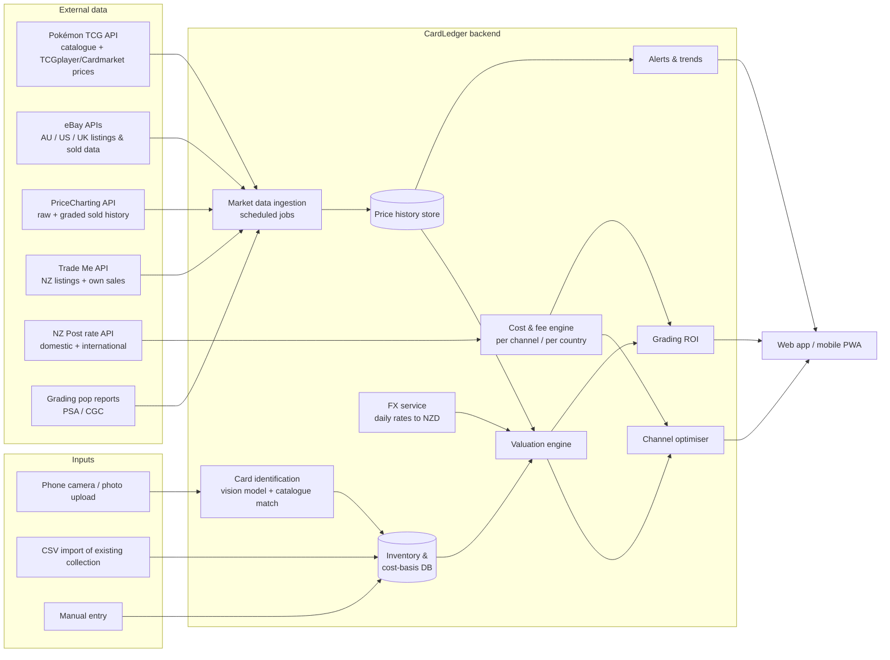

# CardLedger: Pokémon Card Resale Evaluation Platform

**Solution design, v0.2 (New Zealand edition)**

| | |
|---|---|
| **Audience** | A solo collector-reseller in Wellington, New Zealand, who is starting out with an existing collection and runs the business from the family home |
| **Goal** | For every card, answer: *What is it worth, where in the world should I sell it, and what will I actually keep after all costs?* |
| **Home market** | NZ, reporting in **NZD**. Main sales channels are Trade Me for NZ buyers and eBay for Australian, US and UK buyers. Currency and fee tables are configurable. |

---

## 1. Problem statement

A NZ-based reseller with a growing collection runs into five problems:

1. **Price discovery is fragmented, and most of it happens offshore.** The big, liquid markets for Pokémon cards are the US (eBay, TCGplayer), Europe (Cardmarket) and Japan. NZ's own market, mainly Trade Me, is small and thin. A fair price for a NZ seller means converting overseas prices, then adjusting for what it costs to reach those buyers.
2. **Distance is a large cost.** Tracked, insured international postage from NZ costs roughly NZ$25–45 per parcel. That alone can make overseas sales of cards under about NZ$100 lose money, even when the overseas price looks higher.
3. **Several of the obvious marketplaces don't accept NZ sellers.** TCGplayer is built for US sellers. Cardmarket accepts sellers only from Europe and a few other countries. Their prices are still useful as reference data, even though he can't sell on them.
4. **Grading is expensive and slow from NZ.** Fees, insured shipping both ways and possible GST and Customs charges when slabs come back make grading worth it only for the right cards.
5. **There's no business view.** Without tracking what each card cost, he can't see margin, return on capital, stock that isn't selling, or his IRD and GST position.

## 2. What the platform must answer

| # | Question | Feature |
|---|---|---|
| Q1 | What card is this, and what condition is it in? | Card identification and condition pre-assessment |
| Q2 | What is it really selling for now, in NZ and overseas? | Market data aggregation (sold prices, not asking prices) |
| Q3 | What should I list it at? | Valuation engine (fair value, confidence band, liquidity) |
| Q4 | Sell in NZ or overseas, and on which site? | Channel optimiser (net NZD per channel and country) |
| Q5 | Should I grade it first? | Grading ROI calculator (NZ submission costs included) |
| Q6 | How much have I made, what is my stock worth, and what about tax? | Portfolio and P&L dashboard, IRD/GST export |
| Q7 | When should I sell, buy or hold? | Price alerts, trend signals, buy signals (including GST on imported stock) |

## 3. High-level architecture



**Design principles**

- **Use sold prices, not asking prices.** Asking prices only show competition and supply. Trade Me asking prices in particular are often optimistic.
- **Show prices in NZD, after costs.** Every number shown to him answers "what lands in my NZ bank account?"
- **Give a range with a confidence level, not a single number.** A card with 40 sales a week can be priced tightly. A card with 2 sales a quarter can't, and the UI should make that clear.
- **Keep fees in config, not in code.** Marketplace fees, NZ Post rates and exchange rates all change, so they are versioned data that he can edit.

## 4. Components

### 4.1 Inventory and cost basis

Each physical card is one **Item**. Two copies of the same card are two items, because condition and cost can differ.

Each item records:
- Catalogue reference (set, number, variant: holo, reverse holo, 1st Edition, shadowless, promo stamp, **language**. Japanese cards are easy to source from NZ and are a separate market.)
- Condition: raw grade estimate (NM/LP/MP/HP/DMG), or graded (company, grade, cert number)
- **Cost basis in NZD:** purchase price, purchase fees, inbound postage, **GST and Customs charges on imported stock**, and a share of any bulk lot cost
- Acquisition date and source (pack, lot, trade, Trade Me, overseas purchase)
- Status: `in_collection → for_sale → listed → sold → shipped → completed`, or `→ at_grading → graded`
- Photos (front and back, used for listings and condition records)

**Bulk lots.** When he buys a lot of 200 cards for NZ$300, the cost is split across the cards. The default split is in proportion to market value at purchase, with an option to split evenly.

**Personal collection vs business stock.** Each card is tagged as *personal* or *stock*. NZ tax treats the two differently (see 4.9), and the tag also keeps his own keepers out of sell suggestions.

### 4.2 Card identification and condition pre-assessment

- **Identification:** A photo goes to a vision-capable LLM (e.g. Claude), which extracts the set symbol, card number, name, language and variant cues. The result is matched against the catalogue and he confirms the match. This saves a lot of typing when entering an existing collection. It also handles Japanese text.
- **Condition pre-assessment:** The same model, prompted with front and back photos, flags centring (estimated left/right and top/bottom ratios), whitening on edges and corners, surface scratches and print lines. The output is a **likely grade range** (e.g. "PSA 8–9 likely, 10 unlikely: centring ~60/40"). It is a triage aid, not a grade, and the UI says so.

### 4.3 Market data ingestion

Scheduled jobs pull and normalise prices into a single `price_observation` table.

| Source | What it gives | Can he sell here? | Access | Refresh |
|---|---|---|---|---|
| **Pokémon TCG API** (pokemontcg.io) | Full English card catalogue and images; TCGplayer (USD) and Cardmarket (EUR) price summaries | Reference only | Free API key | Daily |
| **eBay APIs** (Browse; Marketplace Insights for sold data) | Active and sold listings on eBay AU, US and UK | **Yes**, the main overseas channel | Free developer account. Sold data needs an application to eBay; PriceCharting is the fallback | Daily per watched card |
| **Trade Me API** | NZ active listings (competition and local pricing), plus his own sales history | **Yes**, the main NZ channel | Free developer registration | Daily |
| **PriceCharting API** | Raw and graded (PSA/CGC/BGS by grade) sold-price history, including Japanese cards | Reference only | Paid subscription (check current pricing) | Daily |
| **Cardmarket / TCGplayer** | EU and US price benchmarks | Not open to NZ sellers | Via Pokémon TCG API summaries | Daily |
| **PSA / CGC population reports** | How many copies exist at each grade, which shows scarcity of high grades | — | Public pages / PSA API | Weekly |
| **FX rates** | NZD against USD, AUD, EUR, GBP and JPY | — | RBNZ or ECB reference rates | Daily |
| **NZ Post rates** | Domestic and international postage by size, weight, value and service | — | NZ Post developer APIs, or a maintained rate card | Monthly |

**Normalisation rules**
- Condition is mapped onto one internal scale. For example, TCGplayer "Near Mint" ≈ Cardmarket "Near Mint" ≈ eBay "Near mint or better". Cardmarket tends to grade more strictly, so the mapping is configurable.
- Each price is stored in its original currency and converted to NZD at the rate on the sale date. Converting at today's rate would distort trends.
- Outliers are dropped: best-offer anomalies, bundle listings and wrong-card matches. Prices outside 1.5×IQR of a card's rolling 90-day window are excluded, and listings whose titles contain lot or bundle keywords are filtered out.
- **NZ thin-market rule:** Trade Me rarely has enough sold data for a card. When it doesn't, the NZ fair value comes from the AU or US price multiplied by a learned NZ discount or premium factor, which is refined from his own Trade Me sales.

### 4.4 Valuation engine

For each item and each market, the engine produces:

- **Fair market value (FMV):** a time-weighted median of comparable sold prices. Recent sales weigh more, with a 30-day half-life.
- **Confidence band:** P25 to P75 of recent comparables.
- **Liquidity score:** sales per 30 days and the estimated days to sell at FMV.
- **Trend:** 30- and 90-day price change, plus a flag for sudden moves (new set announcements, reprints and tournament results all move prices).
- **Condition adjustment:** when there are no comparables for the exact condition, a multiplier applies (e.g. LP ≈ 0.75–0.85× NM). The multiplier is learned from cards that do have data for both conditions.

**Comparables hierarchy** (the engine falls back down the list until it has at least 5 data points):
1. Same card, variant, language and condition/grade, last 30 days
2. Same as above, last 90 days
3. Same card, adjacent condition, with the condition multiplier applied
4. Cross-market price converted to NZD, with a market premium or discount factor applied

### 4.5 Cost and fee engine

This module answers "what will I actually make?". It turns a gross sale price into net NZD.

```
Net proceeds = Sale price (buyer currency → NZD)
             + Postage charged to buyer
             − Marketplace success/final value fee  (Trade Me caps its fee; eBay charges % of total incl. postage)
             − Per-order fixed fee
             − Payment processing fee       (e.g. Trade Me Ping / card fees, PayPal on direct sales)
             − Promoted listing / ad fee    (optional %)
             − FX conversion margin         (spread when eBay pays out in NZD)
             − Actual postage cost          (NZ Post, by destination, size and declared value)
             − Packaging                    (sleeve, top-loader, team bag, bubble mailer / box)
             − Expected returns/dispute cost  (return-rate × avg loss; higher overseas)

Profit       = Net proceeds − Cost basis (incl. any grading costs)
Margin       = Profit / Sale price
ROI          = Profit / Cost basis
Annualised ROI = ROI × (365 / days held)
```

**Fee tables.** These are versioned config. The values below are **indicative only** and must be checked against each platform's current fee page before go-live, because they change often.

| Channel | Success / final value fee | Fixed fee | Payment | Notes |
|---|---|---|---|---|
| **Trade Me (NZ)** | ~7.9% of sale price, capped (~NZ$249) | — | ~2% for card / Ping payments | Lowest fees and cheap domestic postage, but a smaller pool of buyers. Best for cards under ~NZ$100 and for anything locals want. |
| **eBay Australia** | ~13–15% incl. international fee | ~A$0.30–0.40 | included | The closest big market. Postage to Australia is cheaper than to the US. eBay collects Australian GST for low-value imports at checkout. |
| **eBay US** | ~13–15% incl. international fee | ~US$0.30–0.40 | included | The deepest market for graded and high-end cards. Postage from NZ is expensive, and US import rules now hit buyers (see below). |
| **eBay UK** | ~13–15% incl. international fee | ~£0.30–0.40 | included | Can pay for niche or vintage cards. eBay collects UK VAT for low-value imports at checkout. |
| **Direct** (Facebook groups, Discord, Wellington card shops and conventions) | 0% | — | Bank transfer: none. PayPal: ~3%+ | Cash at cons and meet-ups avoids postage. Highest fraud risk for online direct sales. Convention table costs go in overheads. |
| TCGplayer / Cardmarket | — | — | — | Reference prices only, as they don't accept NZ sellers |

**Postage model (NZ Post).** Rates are looked up by destination zone, declared value, size and service:
- **Domestic:** tracked letter or courier bag for single cards (around NZ$5–9), and signature for high-value cards. This cheap domestic postage is a big reason Trade Me does well for lower-value cards.
- **Australia:** International tracked and insured, approximately NZ$25–35.
- **US and UK:** International tracked and insured, approximately NZ$35–50. Insurance limits and declared value bands matter for slabs.

**Rules:**
- If postage plus packaging is more than ~15% of the card's value, the card is flagged "sell in NZ, bundle it, or sell as a lot".
- Overseas buyers often buy several cards at once, so the platform suggests **bundle listings** that spread one international postage cost across multiple cards.

**Break-even guide (from the prototype, indicative).** For the same card at the same USD-equivalent price:

| Card value | Trade Me net | eBay US net |
|---|---|---|
| US$15 (~NZ$26) | NZ$14 | **−NZ$22** |
| US$30 (~NZ$51) | NZ$36 | **≈NZ$0 (break-even)** |
| US$60 (~NZ$102) | NZ$82 | NZ$42 |
| US$150 (~NZ$255) | NZ$218 | NZ$169 |

Overseas only wins when the overseas price is clearly higher than the NZ price, by roughly NZ$40 or more, which is typical for high-end, graded and in-demand cards. Everything else should normally be sold in NZ.

**Cross-border costs, which the platform models as a buyer-landed price:**
- **US buyers:** the US ended its de minimis exemption in 2025, so imports from NZ can attract US duty and carrier brokerage fees for the buyer. That reduces demand and can bring disputes, so the platform discounts US demand accordingly and shows the price the buyer actually pays.
- **Australian and UK buyers:** eBay collects GST or VAT at checkout on low-value imports, so the buyer price includes it. Higher-value parcels may meet border charges.
- **Buying stock from overseas (into NZ):** NZ charges 15% GST on imports. On low-value goods (≤ NZ$1,000) the overseas seller or marketplace collects it at checkout. Above NZ$1,000, NZ Customs collects GST plus clearance and levy charges at the border. All of this is added to the card's **cost basis** automatically.

**Overheads.** Monthly fixed costs (subscriptions, supplies bought in bulk, convention tables, Trade Me listing promotions, insurance) are entered once and spread across sales in the P&L. They are not loaded onto individual cards, so per-card decisions stay clean. Because he lives at home, overheads are low, which is a real advantage early on.

### 4.6 Channel optimiser

For each item, the optimiser evaluates every enabled channel × buyer country:

```
expected_net = net_proceeds(FMV_market) × P(sale within target window)
               − holding_cost × expected_days_to_sell
```

It returns a ranked list, for example:

> **Umbreon VMAX Alt Art 215/203 (NM, raw)**: Best: Trade Me → **NZ$749 net** (FMV NZ$850, ~14 days). Runner-up: eBay US → NZ$747 net (FMV US$560, ~6 days). eBay AU → NZ$721 net.
> *The two are about even on money, but eBay US sells faster. If he wants the cash quickly, choose eBay US; if not, Trade Me.*

It also suggests a **list price** for each channel: FMV plus an offer buffer of around 8–10% when offers are enabled. It also sets a **floor price**, the lowest acceptable offer, worked back from his minimum margin target.

### 4.7 Grading ROI calculator

```
Expected graded value = Σ over grades g:  P(grade = g) × FMV(graded, g)
Grading cost          = grading fee (tier by declared value)
                      + insured shipping NZ → grader and back (or group-submission fee)
                      + GST / Customs on return to NZ, if charged
                      + opportunity cost of capital × turnaround days (often 2–4+ months from NZ)
Grading EV            = net_proceeds(Expected graded value)
                      − Grading cost − net_proceeds(raw FMV)
```

- The grade probabilities `P(grade)` come from the condition pre-assessment (4.2). He can override them, and they are calibrated over time against his actual returned grades. This feedback loop makes the tool better for him specifically.
- **NZ-specific options:** send directly to PSA, CGC or Beckett in the US, or use an **AU/NZ group submission service**, which costs less in shipping and handling per card but has its own fee and adds time. The calculator compares these routes.
- **Batching matters.** Shipping both ways costs about the same whether the box holds one card or 20, so the calculator works out a **submission batch** and suggests which cards to send together.
- Output: "Grade in next PSA batch → EV **+NZ$85**, worst case **−NZ$40**, ~3 months", "Marginal: grade only if confident in condition", or "Sell raw".

### 4.8 Alerts and trends

- A watched card moves ±X% over N days.
- An item in stock crosses his target sell price.
- An item has sat "listed" for more than N days with no sale, so it's time to reprice or move it to another channel.
- A buy alert: a card is listed on Trade Me below FMV × (1 − required margin − costs). Trade Me underpricing by people clearing out old collections is a real sourcing opportunity in NZ.
- An overseas buy alert includes GST and postage into NZ in the landed cost.

### 4.9 Portfolio, P&L and tax (NZ)

- **Dashboard:** total cost basis, current market value (at net-realisable value in NZD), unrealised gain, realised profit this month, quarter and tax year (1 April–31 March), and sell-through rate.
- **Capital efficiency:** money tied up per card and days held, and which purchases performed best.
- **Tax support (NZ):** this is not tax advice. The platform keeps the records an accountant needs and flags these points:
  - **Income tax.** NZ has no general capital gains tax, but profit on goods bought *for the purpose of resale* is taxable income. A resale business is squarely in that category. Profits go on his IR3 return, and he may need to pay provisional tax once it grows. The *personal* vs *stock* tag (4.1) matters here.
  - **GST.** Registration is compulsory once turnover passes **NZ$60,000 in any 12 months**, and the platform warns as he approaches it. Registering voluntarily *before* that could be worth considering: exports to overseas buyers are generally zero-rated, and he could claim GST back on NZ purchases. It also adds admin and GST on NZ sales, so it's a conversation for an accountant.
  - Exports a CSV of income and expenses (fees, postage, supplies, grading, a share of phone and internet) ready for an accountant.
- **Insurance check (because he lives at home):** a growing card collection kept at home may exceed the limits on the family's home contents policy, and many policies exclude **business stock**. The dashboard shows total stock value so it can be compared with the policy, and he may need specified-items or small-business cover.

## 5. Data model (core tables)

```
card_catalogue   (id, set_code, number, name, variant, language, rarity, image_url, external_ids{tcgapi, pricecharting, trademe_category})
item             (id, card_id, ownership[personal|stock], condition_raw, grader, grade, cert_no, status, location, notes, photos[])
acquisition      (id, item_id, lot_id?, date, source, price, currency, fees, postage_in, gst_import, customs_fees, allocated_cost_nzd)
lot              (id, date, total_cost_nzd, allocation_method)
grading_sub      (id, grader, route[direct|group], tier, submitted_at, returned_at, fee, shipping_cost, import_charges, items[])
price_observation(id, card_id, market, channel, condition_norm, grade?, price, currency, price_nzd, sold_at, is_sold, source_ref)
fx_rate          (date, ccy, rate_to_nzd)
fee_schedule     (id, channel, region, effective_from, pct_fee, fee_cap, fixed_fee, payment_pct, payment_fixed, rules_json)
postage_rate     (id, carrier, service, zone, max_value, max_weight, cost_nzd)
valuation        (item_id, market, as_of, fmv, p25, p75, sales_30d, trend_30d, confidence)
listing          (id, item_id, channel, region, list_price, floor_price, listed_at, status)
sale             (id, item_id, listing_id, sold_at, price, currency, postage_charged, fees_actual, postage_actual, packaging, net_nzd, profit_nzd)
overhead         (id, month, category, amount_nzd)
alert_rule       (id, type, card_id?, item_id?, threshold, active)
```

Recording **actual** fees on each `sale` lets the system reconcile its estimates against real payouts and correct the fee tables when they drift.

## 6. Worked example

Card: Umbreon VMAX Alt Art 215/203 (Evolving Skies), raw NM. Bought in a lot; allocated cost **NZ$380**.

FX (illustrative): 1 USD = NZ$1.70, 1 AUD = NZ$1.10.

| | Trade Me (NZ) | eBay US | eBay Australia |
|---|---|---|---|
| FMV (local) | NZ$850 | US$560 | A$820 |
| FMV in NZD | NZ$850.00 | NZ$952.00 | NZ$902.00 |
| Success / final value fee | −NZ$67.15 (7.9%) | −NZ$142.80 (15%) | −NZ$130.79 (14.5%) |
| Fixed / payment fee | −NZ$16.57 (1.95%) | −NZ$0.68 | −NZ$0.44 |
| FX spread on payout | — | −NZ$9.52 (1%) | −NZ$9.02 (1%) |
| Postage (NZ Post, tracked/insured) | −NZ$7.00 | −NZ$40.00 | −NZ$30.00 |
| Packaging | −NZ$2.00 | −NZ$2.00 | −NZ$2.00 |
| Returns allowance (1%) | −NZ$8.50 | −NZ$9.52 | −NZ$9.02 |
| **Net proceeds** | **NZ$748.77** | **NZ$747.48** | **NZ$720.73** |
| Cost basis | −NZ$380 | −NZ$380 | −NZ$380 |
| **Profit** | **NZ$368.77** | **NZ$367.48** | **NZ$340.73** |
| Margin | 43.4% | 38.6% | 37.8% |

The US headline price is NZ$102 higher than the Trade Me price, but fees and postage take almost all of that difference. Without a tool like this, the higher overseas price looks like the obvious choice. With it, the choice comes down to selling speed and the risk of selling overseas. All figures are illustrative. The prototype in `/prototype` reproduces them from `fees.json`.

## 7. Technology choices

The platform is sized for one user, needs very little operations work, and can grow later.

| Layer | Choice | Why |
|---|---|---|
| Frontend | Next.js (React) as a PWA | One codebase for desktop and phone. The phone camera handles card capture at cons and card shops. |
| Backend API | Python + FastAPI | Python suits the data and pricing maths (pandas). It's simple to host. |
| Database | PostgreSQL (Supabase or Neon free tier; choose the Sydney region for low latency) | Relational data fits inventory and accounting. Auth and storage are included. |
| Image storage | Supabase Storage / S3 (Sydney region) | Card photos |
| Scheduled jobs | Cron worker (GitHub Actions schedule, or a small Render/Fly worker) | Daily price pulls are low volume |
| Card ID / condition | Claude vision via the Anthropic API | Cheap per card at this volume, and it handles Japanese cards |
| Charts | Recharts | Price history and P&L |
| Hosting | Vercel (frontend) + Render/Fly (API) | About NZ$0–40/month at this scale |

**Estimated running cost (first usable version):** about NZ$15–70/month, mostly the PriceCharting subscription and LLM usage. Free tiers cover the rest. If he'd rather not run software, the cost engine could also be built as a Google Sheet with the same formulas during Phase 0.

## 8. Delivery roadmap

| Phase | Scope | Outcome |
|---|---|---|
| **0: Prototype** (done in this repo) | NZD profit and channel calculator with editable fees (`/prototype`) | He can check real sell-here-or-overseas decisions today |
| **1: First usable version** (~4–6 weeks part-time) | Inventory + CSV import, catalogue and reference prices, FX to NZD, NZ Post postage, cost engine, channel comparison, basic dashboard | Every card valued in NZD and ranked by net profit |
| **2: Market depth** | eBay AU/US sold data (Insights API or PriceCharting), Trade Me integration, graded prices, confidence and liquidity, listing tracker, actual-vs-estimated fee reconciliation | Trustworthy prices; tracked P&L |
| **3: Smart assist** | Photo identification, condition pre-assessment, grading ROI with batch builder, alerts and Trade Me buy signals | Faster intake, better grading and buying decisions |
| **4: Scale** | Listing creation via the eBay and Trade Me APIs, bulk repricing, international bundle builder, Japanese market, tax-year and GST exports | Operational tool for a real business |

## 9. Risks and mitigations

| Risk | Mitigation |
|---|---|
| eBay sold-data API access refused | Use PriceCharting as the primary graded and sold source. Pokémon TCG API prices are the baseline. Add manual comp entry. |
| Thin NZ market gives misleading Trade Me prices | Derive the NZ value from AU/US prices with a learned NZ factor, and show confidence clearly. |
| International parcels lost or damaged | Use tracked and insured services above a value threshold, record photos before posting, and include a returns and loss allowance in costs. |
| US import charges reduce demand or cause disputes | Model the buyer-landed price, state import charges clearly in listings, and lean towards AU or NZ buyers for mid-value cards. |
| Fee, postage and FX tables go stale | Store them as versioned data, reconcile against actual payouts, and alert when they drift by more than 1%. |
| Thin markets give misleading FMV | Show a confidence band and liquidity score, and refuse to show a single number when there are fewer than 3 comparables. |
| Over-trusting the AI condition estimate | Label it a triage aid, calibrate it on his own grading returns, and never put it in listings as a grade. |
| Fakes when buying stock (common on Facebook and in cheap overseas lots) | Add a checklist in the buy flow (light test, font, texture, holo pattern). Flag prices that look too cheap. |
| Collection not insured | Show total stock value on the dashboard and prompt a policy check (4.9). |
| Tax and GST compliance | Keep the ledger and exports, warn at the GST threshold, and recommend an accountant. |
| Terms-of-service breaches through scraping | Use only official APIs and licensed data providers. |

## 10. Open questions

1. Roughly how many cards does he have, and what value range? A bulk-heavy collection (many cards under NZ$10) needs Trade Me lot-selling tools more than single-card pricing.
2. English only, or Japanese as well?
3. Does he already have Trade Me and eBay seller accounts, and does he use Trade Me's Ping payments?
4. Does he sell at Wellington events or card shops? If so, offline sales tracking moves up the roadmap.
5. Does he want the platform to post listings automatically (Phase 4), or only advise?
