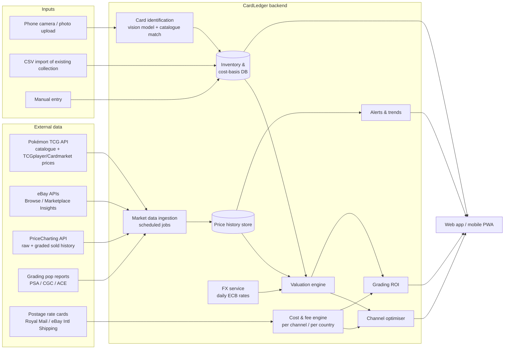

# CardLedger: Pokémon Card Resale Evaluation Platform

**Solution design, v0.1**

| | |
|---|---|
| **Audience** | A solo collector-reseller who is starting out with an existing collection |
| **Goal** | For every card, answer: *What is it worth, where in the world should I sell it, and what will I actually keep after all costs?* |
| **Base assumption** | Seller is UK-based and reports in GBP. Currency and fee tables are configurable, so another home market only changes settings. |

---

## 1. Problem statement

A reseller with a growing collection runs into four problems:

1. **Price discovery is fragmented.** The same card sells at different prices on eBay (US, UK, DE, AU), TCGplayer (US), Cardmarket (EU), and the Japanese market. Each site uses its own currency and its own condition scale.
2. **The headline price misleads.** Fees, payment processing, postage, packaging, grading, currency conversion, import duty and returns can take 20–40% of the price on a mid-value card. On a cheap card they can take all of it.
3. **The decision to grade is expensive and hard to call.** Paying £20–£100+ to grade a card only pays off when the price gap between graded and raw copies beats the cost, the turnaround time and the risk of a lower grade than hoped.
4. **There's no business view.** Without tracking cost basis, the seller can't see margin, return on capital, stock that isn't selling, or tax position.

## 2. What the platform must answer

| # | Question | Feature |
|---|---|---|
| Q1 | What card is this, and what condition is it in? | Card identification and condition pre-assessment |
| Q2 | What is it really selling for now, in each market? | Market data aggregation (sold prices, not asking prices) |
| Q3 | What should I list it at? | Valuation engine (fair value, confidence band, liquidity) |
| Q4 | Where should I sell it to keep the most money? | Channel optimiser (net proceeds per marketplace and country) |
| Q5 | Should I grade it first? | Grading ROI calculator |
| Q6 | How much have I made, and what is my stock worth? | Portfolio and P&L dashboard, tax export |
| Q7 | When should I sell, buy or hold? | Price alerts and trend signals |

## 3. High-level architecture



**Design principles**

- **Use sold prices, not asking prices.** An asking price shows what someone hopes to get, not what buyers pay. Asking prices only show competition and supply.
- **Show prices in the seller's currency, after costs.** Every number shown to the user answers "what lands in my bank account?"
- **Give a range with a confidence level, not a single number.** A card with 40 sales a week can be priced tightly. A card with 2 sales a quarter can't, and the UI should make that clear.
- **Keep fees in config, not in code.** Marketplace fees change several times a year, so fee tables are versioned data that the user can edit.

## 4. Components

### 4.1 Inventory and cost basis

Each physical card is one **Item** (two copies of the same card are two items, because condition and cost can differ).

Each item records:
- Catalogue reference (set, number, variant: holo, reverse holo, 1st Edition, shadowless, promo stamp, language)
- Condition: raw grade estimate (NM/LP/MP/HP/DMG), or graded (company, grade, cert number)
- **Cost basis:** purchase price, purchase fees, inbound postage, and a share of any bulk lot cost
- Acquisition date and source (pack, lot, trade, purchase)
- Status: `in_collection → for_sale → listed → sold → shipped → completed`, or `→ at_grading → graded`
- Photos (front and back, used for listings and condition records)

**Bulk lots.** When he buys a lot of 200 cards for £150, the cost is split across the cards. The default split is in proportion to market value at purchase, with an option to split evenly. Without this split, per-card margin can't be calculated.

### 4.2 Card identification and condition pre-assessment

- **Identification:** A photo goes to a vision-capable LLM (e.g. Claude), which extracts the set symbol, card number, name, language and variant cues. The result is matched against the Pokémon TCG API catalogue and the user confirms the match. This saves a lot of typing when entering an existing collection.
- **Condition pre-assessment:** The same model, prompted with front and back photos, flags centring (estimated left/right and top/bottom ratios), whitening on edges and corners, surface scratches and print lines. The output is a **likely grade range** (e.g. "PSA 8–9 likely, 10 unlikely: centring ~60/40"). It is a triage aid, not a grade, and the UI says so.

### 4.3 Market data ingestion

Scheduled jobs pull and normalise prices into a single `price_observation` table.

| Source | What it gives | Access | Refresh |
|---|---|---|---|
| **Pokémon TCG API** (pokemontcg.io) | Full English card catalogue and images; embedded TCGplayer (USD) and Cardmarket (EUR) price summaries | Free API key | Daily |
| **eBay Browse API** | Active listings by marketplace (UK, US, DE, AU…), used for supply and competition | Free developer account | Daily per watched card |
| **eBay Marketplace Insights API** | **Sold** listings, the most useful data source | Restricted: requires an application to eBay. Fallback: PriceCharting or 130point-style sold data | Daily |
| **PriceCharting API** | Raw and graded (PSA/CGC/BGS by grade) sold-price history, including Japanese cards | Paid subscription (~$X/month, check current pricing) | Daily |
| **Cardmarket** | EU trend price, lowest price by condition, price by language | API limited to professional sellers; Pokémon TCG API summary is the fallback | Daily |
| **PSA / CGC population reports** | How many copies exist at each grade, which shows scarcity of high grades | Public web pages / PSA API | Weekly |
| **FX rates** | GBP/USD/EUR/JPY/AUD | ECB reference rates (free, e.g. via the Frankfurter API) | Daily |

**Normalisation rules**
- Condition is mapped onto one internal scale. For example, TCGplayer "Near Mint" ≈ Cardmarket "Near Mint" ≈ eBay "Near mint or better". Cardmarket tends to grade more strictly, so the mapping is configurable.
- Each price is stored in its original currency and converted at the rate on the sale date. Converting at today's rate would distort trends.
- Outliers are dropped: best-offer anomalies, bundle listings and wrong-card matches. Prices outside 1.5×IQR of a card's rolling 90-day window are excluded, and listings whose titles contain lot or bundle keywords are filtered out.

### 4.4 Valuation engine

For each item and each market, the engine produces:

- **Fair market value (FMV):** a time-weighted median of comparable sold prices. Recent sales weigh more, with a 30-day half-life.
- **Confidence band:** P25 to P75 of recent comparables.
- **Liquidity score:** sales per 30 days and the estimated days to sell at FMV.
- **Trend:** 30- and 90-day price change, plus a flag for sudden moves (new set announcements, reprints and tournament results all move prices).
- **Condition adjustment:** when there are no comparables for the exact condition, a multiplier applies (e.g. LP ≈ 0.75–0.85× NM). The multiplier is learned from cards that do have data for both conditions.

**Comparables hierarchy** (the engine falls back down the list until it has at least 5 data points):
1. Same card, variant, language and condition/grade, last 30 days
2. Same as above, last 90 days
3. Same card, adjacent condition, with the condition multiplier applied
4. Cross-market price converted via FX, with a market premium/discount factor applied

### 4.5 Cost and fee engine

This module answers "what will I actually make?". It turns a gross sale price into net proceeds.

```
Net proceeds = Sale price (in buyer currency, converted to GBP)
             + Postage charged to buyer
             − Marketplace final value fee  (% of total incl. postage on eBay)
             − Per-order fixed fee
             − Payment processing fee       (where separate, e.g. TCGplayer, PayPal)
             − Promoted listing / ad fee    (optional %)
             − FX conversion margin         (platform's spread on payouts)
             − Actual postage cost          (tracked/insured; varies by destination & value)
             − Packaging                    (sleeve, top-loader, team bag, bubble mailer)
             − Expected returns/dispute cost  (return-rate × avg loss)

Profit       = Net proceeds − Cost basis (incl. any grading costs)
Margin       = Profit / Sale price
ROI          = Profit / Cost basis
Annualised ROI = ROI × (365 / days held)
```

**Fee tables.** These are versioned config. The values below are indicative only and must be checked against each platform's current fee page before go-live, because they change often.

| Channel | Final value / commission | Fixed fee | Payment | Notes |
|---|---|---|---|---|
| eBay UK (business seller, trading cards) | ~10–13% of total | ~£0.30–0.40/order | included | Business sellers pay fees. Private-seller fee exemptions don't apply to a business. |
| eBay US (international listing) | ~13–15% + international fee | ~$0.30–0.40 | included | eBay International Shipping can handle customs |
| TCGplayer (US) | ~10–11% | — | ~2.5% + $0.30 | Needs a US-facing seller setup and has tight condition standards |
| Cardmarket (EU) | ~5% | — | — | Low fees and buyers expect cheap tracked post. Strong for EU buyers and for German, French and Italian cards. |
| Direct / social (Instagram, Discord, card shows) | 0% | — | PayPal G&S ~3% + fixed fee | Highest fraud risk; card show table costs go in as overheads |

**Postage model.** Rates are looked up by destination zone, declared value band and service. Royal Mail Large Letter suits low-value cards. Tracked or Special Delivery is used above a threshold, e.g. £50. International Tracked & Signed and insured services cover graded slabs. **Rule:** if postage plus packaging exceeds ~15% of FMV, the card is flagged as "bundle or bulk-sell, don't single-list".

**Cross-border costs.** For sales into the US, the US ended its de minimis exemption in 2025, so buyers may face import duty and brokerage fees. That suppresses demand or forces delivery-duty-paid pricing, unless the sale routes through eBay International Shipping, which collects duty at checkout. Sales into the EU attract import VAT, collected at checkout for consignments up to €150. The platform models a **buyer-landed price**, so it can tell when a market that looks cheaper is really more expensive for the buyer.

**Overheads.** Monthly fixed costs (subscriptions, storage, supplies bought in bulk, card show tables) are entered once and spread across sales in the P&L. They are not loaded onto individual cards, so per-card decisions stay clean.

### 4.6 Channel optimiser

For each item, the optimiser evaluates every enabled channel × buyer region:

```
expected_net = net_proceeds(FMV_market) × P(sale within target window)
               − holding_cost × expected_days_to_sell
```

It returns a ranked list, for example:

> **Charizard ex 199/165 SIR (NM, raw)**: Best: eBay US via eBay International Shipping → **£148 net** (FMV $215, ~9 days). Runner-up: Cardmarket DE → £139 net (FMV €176, ~5 days). eBay UK → £131 net.

It also suggests a **list price** for each channel: FMV plus an offer buffer of around 8–10% when Best Offer is enabled. It also sets a **floor price**, the lowest acceptable offer, worked back from the user's minimum margin target.

### 4.7 Grading ROI calculator

```
Expected graded value = Σ over grades g:  P(grade = g) × FMV(graded, g)
Grading cost          = grading fee (tier by declared value)
                      + shipping to/from grader (insured)
                      + import/customs on return if grading abroad
                      + opportunity cost of capital × turnaround days
Grading EV            = net_proceeds(Expected graded value)
                      − Grading cost − net_proceeds(raw FMV)
```

- The grade probabilities `P(grade)` come from the condition pre-assessment (4.2). The user can override them, and they are calibrated over time against his actual returned grades. This is a feedback loop that makes the tool better for him specifically.
- It compares PSA, CGC, ACE (UK-based, with fast turnaround and no customs for UK sellers) and Beckett.
- Output: "Grade with ACE → EV **+£42**, worst-case **−£18**, 4–6 weeks", or "Sell raw".

### 4.8 Alerts and trends

- A watched card moves ±X% over N days.
- An item in stock crosses the user's target sell price.
- An item has sat "listed" for more than N days with no sale, so it's time to reprice or move it to another channel.
- A buy alert: a card is listed below FMV × (1 − required margin − costs). This helps with buying stock, not just selling it.

### 4.9 Portfolio, P&L and tax

- **Dashboard:** total cost basis, current market value (at net-realisable value, not gross), unrealised gain, realised profit this month, quarter and tax year, and sell-through rate.
- **Capital efficiency:** money tied up per card and days held, and which purchases performed best.
- **Tax support (UK):** an income and expenses ledger exported as CSV that lines up with Self Assessment categories. It flags when he passes the £1,000 trading allowance and records platform-reported totals. eBay and others now report seller income to HMRC under the digital platform reporting rules. This is not tax advice, and the doc recommends speaking to an accountant once the business is meaningful.

## 5. Data model (core tables)

```
card_catalogue   (id, set_code, number, name, variant, language, rarity, image_url, external_ids{tcgapi, pricecharting, cardmarket})
item             (id, card_id, condition_raw, grader, grade, cert_no, status, location, notes, photos[])
acquisition      (id, item_id, lot_id?, date, source, price, fees, postage_in, allocated_cost)
lot              (id, date, total_cost, allocation_method)
grading_sub      (id, grader, tier, submitted_at, returned_at, fee, shipping_cost, items[])
price_observation(id, card_id, market, channel, condition_norm, grade?, price, currency, price_gbp, sold_at, is_sold, source_ref)
fx_rate          (date, ccy, rate_to_gbp)
fee_schedule     (id, channel, region, effective_from, pct_fee, fixed_fee, payment_pct, payment_fixed, rules_json)
postage_rate     (id, carrier, service, zone, max_value, max_weight, cost)
valuation        (item_id, market, as_of, fmv, p25, p75, sales_30d, trend_30d, confidence)
listing          (id, item_id, channel, region, list_price, floor_price, listed_at, status)
sale             (id, item_id, listing_id, sold_at, price, currency, postage_charged, fees_actual, postage_actual, packaging, net_gbp, profit_gbp)
overhead         (id, month, category, amount)
alert_rule       (id, type, card_id?, item_id?, threshold, active)
```

Recording **actual** fees on each `sale` lets the system reconcile its estimates against real payouts and correct the fee tables when they drift.

## 6. Worked example

Card: Umbreon VMAX Alt Art 215/203 (Evolving Skies), raw NM. Bought in a lot; allocated cost **£180**.

| | eBay UK | eBay US (via eBay International Shipping) | Cardmarket DE |
|---|---|---|---|
| FMV (local) | £420 | $560 | €495 |
| FMV in GBP (illustrative FX, GBP per unit) | £420.00 | £420.00 (@0.75) | £416.99 (@0.8424) |
| Postage charged to buyer | £0 (free P&P) | £0 | £0 |
| Final value fee | −£54.60 (13%) | −£63.00 (15% incl. intl) | −£20.85 (5%) |
| Fixed / payment fee | −£0.40 | −£0.30 | — |
| FX spread on payout | — | −£4.20 (1%) | −£4.17 (1%) |
| Postage (tracked, insured) | −£8.50 | −£4.00 (to eBay hub) | −£16.00 |
| Packaging | −£1.20 | −£1.20 | −£1.20 |
| Returns allowance (1%) | −£4.20 | −£4.20 | −£4.17 |
| **Net proceeds** | **£351.10** | **£343.10** | **£370.60** |
| Cost basis | −£180 | −£180 | −£180 |
| **Profit** | **£171.10** | **£163.10** | **£190.60** |
| Margin | 40.7% | 38.8% | 45.7% |

The headline prices are almost identical, but net profit differs by about £27 depending on channel. That spread is what the optimiser captures. All figures here are illustrative. The prototype in `/prototype` reproduces this calculation from editable config.

## 7. Technology choices

The platform is sized for one user, needs very little operations work, and can grow later.

| Layer | Choice | Why |
|---|---|---|
| Frontend | Next.js (React) as a PWA | One codebase for desktop and phone. The phone camera handles card capture at shows. |
| Backend API | Python + FastAPI | Python suits the data and pricing maths (pandas). It's simple to host. |
| Database | PostgreSQL (Supabase or Neon free tier) | Relational data fits inventory and accounting. Auth and storage are included. |
| Image storage | Supabase Storage / S3 | Card photos |
| Scheduled jobs | Cron worker (GitHub Actions schedule, or a small Render/Fly worker) | Daily price pulls are low volume |
| Card ID / condition | Claude vision via the Anthropic API | Cheap per card at this volume, and it handles Japanese cards |
| Charts | Recharts | Price history and P&L |
| Hosting | Vercel (frontend) + Render/Fly (API) | About £0–£25/month at this scale |

**Estimated running cost (MVP):** about £10–£40/month, mostly the PriceCharting subscription and LLM usage. Free tiers cover the rest. If he'd rather not run software, the cost engine could also be built as a Google Sheet with the same formulas. That would work as a stopgap during Phase 0.

## 8. Delivery roadmap

| Phase | Scope | Outcome |
|---|---|---|
| **0: Prototype** (done in this repo) | Profit and channel calculator with editable fee config (`/prototype`) | He can check real decisions today |
| **1: MVP** (~4–6 weeks part-time) | Inventory + CSV import, Pokémon TCG API catalogue and prices, FX, cost engine, channel comparison, basic dashboard | Every card valued and ranked by net profit |
| **2: Market depth** | eBay sold data (Insights API or PriceCharting), graded prices, valuation confidence and liquidity, listing tracker, actual-vs-estimated fee reconciliation | Trustworthy prices; tracked P&L |
| **3: Smart assist** | Photo identification, condition pre-assessment, grading ROI, alerts, buy signals | Faster intake, better grading decisions |
| **4: Scale** | eBay listing creation via the Sell APIs, bulk repricing, Japanese market, tax-year exports, multi-user if the venture grows | Operational tool for a real business |

## 9. Risks and mitigations

| Risk | Mitigation |
|---|---|
| eBay sold-data API access refused | Use PriceCharting as the primary graded and sold source. Pokémon TCG API prices are the baseline. Add manual comp entry. |
| Fee and postage tables go stale | Store fee schedules as versioned data. Reconcile them against actual sale payouts and alert when they drift by more than 1%. |
| Thin markets give misleading FMV | Show a confidence band and liquidity score, and refuse to show a single number when there are fewer than 3 comparables. |
| Condition mismatch causes returns and disputes | Grade conservatively, require photos before listing, and include a returns allowance in the costs. |
| Over-trusting the AI condition estimate | Label it a triage aid, calibrate it on his own grading returns, and never put it in listings as a grade. |
| Fakes and re-sealed product when buying stock | Add a checklist in the buy flow (light test, font, texture, holo pattern). Flag prices that look too cheap. |
| Terms-of-service breaches through scraping | Use only official APIs and licensed data providers. |
| Tax compliance | Keep the ledger and exports, and flag thresholds. Recommend an accountant. |

## 10. Open questions for the user

1. Which country is he based in? This doc assumes the UK, which affects fees, postage, tax and the grader shortlist.
2. Roughly how many cards, and what value range? A bulk-heavy collection (many cards under £5) needs bundle and lot-selling tools more than single-card pricing.
3. English only, or also Japanese and other languages?
4. Which channels does he already sell on, and does he have business seller accounts?
5. Does he want the platform to post listings automatically (Phase 4), or only advise?
